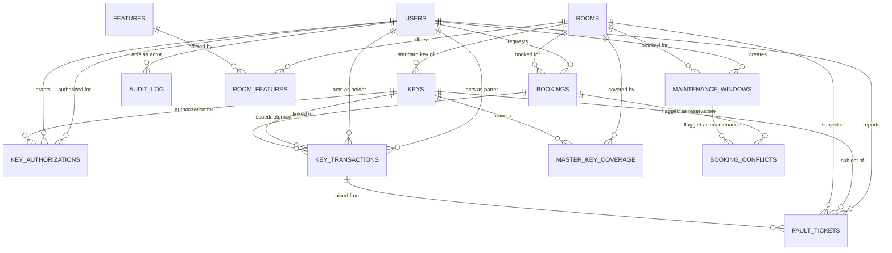
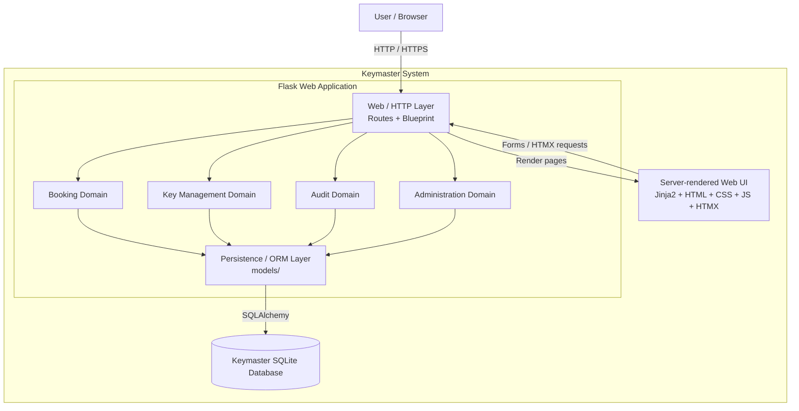

# pe-projekt-lab-2671
A small Python application for university room and key management.

## Installation

### Prequisites
- Docker or Docker Desktop (latest)
- docker-compose

### Quickstart Guide

This will start your app on `localhost:5000`

```
git clone https://github.com/friendlyhomeinvader/pe-projekt-lab-2671.git
cd pe-projekt-lab-2671
docker compose up --build
```


## Features

## Login
Users can log in to the application using their credentials on the Authentication screen to access the available features.

## Navigation Flow
Users can navigate between the different application screens through a clear and list style navigation system.

## Booking Flow
Users can check available booking options, select a preferred date and time slot, and submit a booking request, by 5 minute intervals. 

## Admin
Administrators have access to management features, allowing them to manage users, rooms, bookings, and system settings.

## Operator
Operator handle room keys, ensuring that only authorized users can access specific rooms.

## Extra feature
**Multibooking.** On the booking screen, a requester can check "Repeat
this slot weekly (multibooking)" when picking a time slot and choose how
many additional weeks to repeat it for (1-13, so up to 14 bookings in
one go: the picked week plus 13 more). The same room, day of week, and
time are booked for every selected week. A confirmation dialog lists the
exact dates before anything is created, and if any of the weeks would
conflict with an existing booking or a maintenance slot, nothing is
booked at all (all-or-nothing) — the conflicting date is named so the
request can be adjusted and retried.

## Documentation

### Web application
- Python, Flask
- Flask-migrate, Flask-sqlalchemy
- Jinja2 templates
- HTMX

### DBMS
- SQLite

### Tooling
- pytest
- ruff

### API documentation
API documentation (Swagger UI) can found under at [`/docs`](http://localhost:5000/docs)

## ER-diagram:


## Contener diagram
